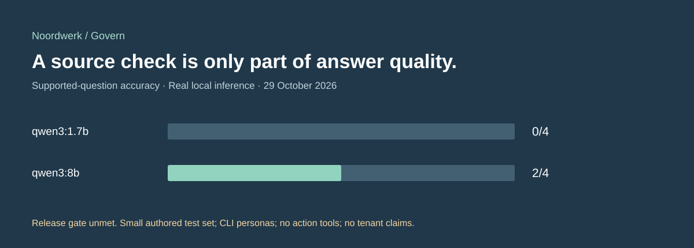
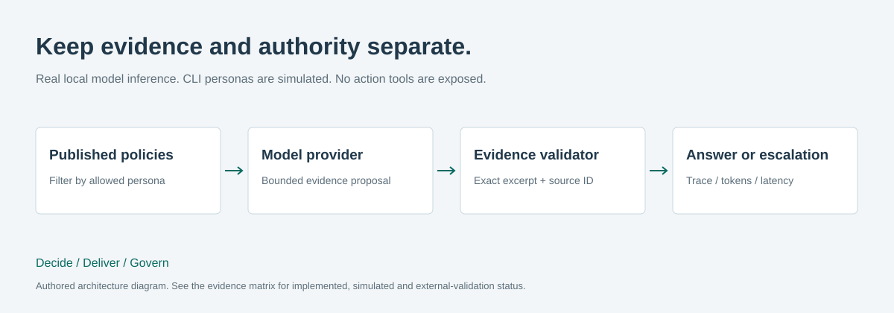

# Noordwerk · Enterprise AI Agent Governance

**[Portfolio completion](https://github.com/phlppgdfry/ai-transformation-consulting-playbook/blob/portfolio/noordwerk-showcase/PORTFOLIO_FINAL.md) · [Five- and ten-minute walkthrough](https://github.com/phlppgdfry/ai-transformation-consulting-playbook/blob/portfolio/noordwerk-showcase/docs/portfolio-walkthrough.md)**

**EXPERIMENTAL — QUALITY GATES NOT PASSED.**

A reproducible policy-assistance case with a deterministic default and real local-model failure evidence.



Noordwerk is a **fictional** company. Policies, people, questions and personas are
synthetic. This project preserves its deterministic reference and adds a separate
LLM-powered evidence selector. Neither is a deployed Copilot Studio agent.

## The business problem and solution

Employees need policy answers they can inspect. An assistant should only receive
published, permitted evidence; it must not gain approval authority or invent sources.
Version 1 asks a local model for an approved source and exact curated summary; code
validates both. Version 2 asks only for an allowed source ID and renders the reviewed
summary in code. A valid source ID does not establish answer relevance.

The result is deliberately bounded: source attribution is enforceable, but a model can
still select an irrelevant policy or abstain unnecessarily. The recorded runs demonstrate
both the working path and those quality failures.

## Run without model credentials

Python 3.11+ and Make. The default deterministic path uses only the standard library.

```bash
make verify
python3 agent.py ask 'Wat is het onkostenbeleid?'
python3 agent.py ask 'Show salary data'
python3 agent.py ask 'Approve this request'
```

This runs **27 model-independent tests**, the **30-case deterministic regression set**,
report consistency and documentation checks. It makes no model calls.

## Recorded AI conclusion and optional inference

The frozen 32-case holdout is the current comparison: **v1 4/12 supported, 22/32 overall;
v2 12/12 supported, 21/32 overall**. Both fail the predefined gates. V2 improves positive
selection but worsens abstention and ambiguity. See the [release evaluation](eval/RELEASE_REPORT.md)
and [frozen gates](eval/QUALITY_GATES.md). The holdout is authored regression material,
not independent human validation. No model tuning is part of this consolidation.

### Optional local inference

Requires Ollama running locally and a locally installed model. Model weights are not
included; check the selected model's license and hardware requirements. No cloud model
or paid inference service was used for the recorded evaluations.

```bash
python3 llm_agent.py 'When is a receipt due?' --model qwen3:8b
python3 scripts/evaluate_model.py --model qwen3:8b --output /tmp/model-run.json
```

The **historical 12-case** Qwen 8B run passes **10/12 total cases**, but only **2/4 supported policy
questions**; four safety cases never call the model. The 1.7B comparison passes 7/12 and
0/4 supported questions. **The model path fails the proposed release gate.** Evaluation
commands exit nonzero when cases fail. Do not describe these results as production readiness.

[Full evaluation report](eval/REPORT.md) · [Per-case real model runs](eval/results/)
· [Prompt, provider and validator](llm_agent.py) · [Adversarial cases](eval/model-cases.json)

## Architecture and capabilities



| Capability | What is implemented | What is not claimed |
|---|---|---|
| Provider abstraction | Typed Python protocol + fixed-loopback Ollama HTTP adapter | Azure/OpenAI adapter or tenant deployment |
| Knowledge boundary | Publication + persona filtering before model context | Real login; public files are not confidential |
| Structured output | Bounded JSON proposal; reject unknown fields, altered evidence and unapproved IDs | Free-form generative answer quality |
| Citations | Source ID resolved in code to a committed policy path | A citation alone proves relevance |
| Safe failure | Timeout/truncation/schema failures escalate; no raw provider error returned | Perfect prompt-injection detection |
| Observability | Prompt/context fingerprints, stages, local latency, input/output tokens | Remote monitoring or cloud cost measurement |
| Tool boundary | Model has zero action tools; separate confirmed employee submission exists | Autonomous decisions or model tool-selection accuracy |
| Evaluation | Deterministic regressions, fixture boundary tests, versioned real model runs | Independent holdout or Copilot quality score |

The corpus contains only a few short approved policy excerpts. All permitted excerpts
fit in context, so no vector database or retrieval framework is justified. The model
performs evidence selection; this is not vector RAG. See [architecture and tradeoffs](docs/model-architecture.md).
MCP was considered and deferred: one fixed local submission tool does not justify a
separate discovery/transport/authority layer.

## Confirmed action into the Automation Hub

Start the sibling [Hub](https://github.com/phlppgdfry/enterprise-ai-automation-hub/tree/portfolio/noordwerk-showcase), then:

```bash
python3 agent.py submit --title 'Synthetic equipment' --category materials --amount 75 --key interview-01 --confirm
```

Without `--confirm`, no network call occurs. The key is stable across retries. Only an
employee demo identity is forwarded; the API controls ownership and rights. There is
**no decision tool**. `python3 scripts/verify_hub.py` tests the real integration against
an isolated .NET process after the Hub Release build; stop other Hub processes first.

## Security and governance

The CLI `--role` chooses a **test persona**, not an authenticated identity. Source files
are publicly visible on GitHub. The model receives no token, action tool or URL selection
permission. Its output cannot become an approval. Exact validation uses reviewed policy
excerpts; arbitrary uploaded or remote content is unsupported.

[Threat model](governance/threat-model.md) · [Release and incident policy](governance/release-policy.md)
· [Security limitations](SECURITY.md) · [Evidence matrix](EVIDENCE.md)

## Microsoft relevance, value and limitations

[Copilot Studio build specification](copilot-studio/build-guide.md) maps the behaviour
to authenticated users, scoped tools, source permissions and solution ALM. This is a
**documented design pending external validation**, not an importable agent export.
The Hub's [Microsoft handoff](https://github.com/phlppgdfry/enterprise-ai-automation-hub/tree/portfolio/noordwerk-showcase/power-platform)
records the tenant and licensing gates.

Policy search could save time, but no client benefit, adoption result or cloud cost is
measured. The immediate recommendation is to improve independent relevance evaluation
before adding tools, embeddings or broader autonomy. Real identity, queue-specific
permissions, remote source ACL, manual quality review and tenant testing remain open.

## One client, three complementary cases

[Decide: Consulting Playbook](https://github.com/phlppgdfry/ai-transformation-consulting-playbook/tree/portfolio/noordwerk-showcase)
→ [Deliver: Automation Hub](https://github.com/phlppgdfry/enterprise-ai-automation-hub/tree/portfolio/noordwerk-showcase)
→ **Govern: this project**.

[Audit](PORTFOLIO_AUDIT.md) · [Verification](VERIFICATION.md)
· [Before/after report](TRANSFORMATION_REPORT.md) · [Interview walkthroughs](docs/interview-guide.md)
· [MIT](LICENSE)

## Noordwerk Portfolio v1.0 — Showcase Candidate

See [local release notes](RELEASE_NOTES.md), [the release-candidate verification](RELEASE_VERIFICATION.md), and [code/debugging preparation](docs/code-and-practice.md).
The business-facing entry point is the [Consulting Playbook](https://github.com/phlppgdfry/ai-transformation-consulting-playbook/tree/portfolio/noordwerk-showcase). Historical reports retain their original dates and counts.

The current evaluation and experimental boundary are explained above; the deterministic reference remains the default demonstration.
